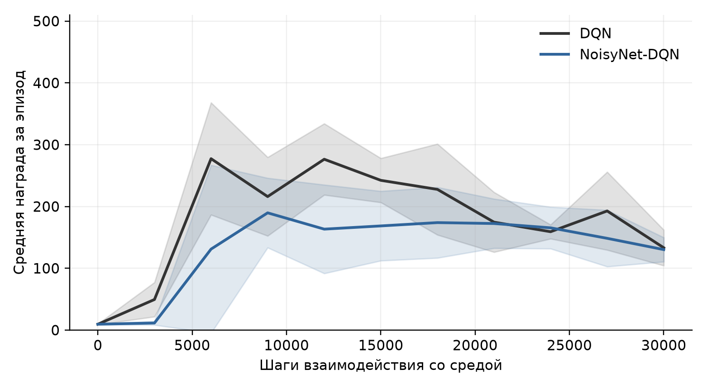

# NoisyNets в обучении с подкреплением

Промежуточный этап курсовой работы по МГМО. Автор: Горбунов Иван Олегович, ИУ6-74б.

[Промежуточная РПЗ](reports/РПЗ_Горбунов_МГМО_NoisyNets_для_отправки.docx) · [Ноутбук с результатами](notebooks/01_pilot_study.ipynb)

Тема: «Применение нейронных сетей с параметрическим шумом (NoisyNets) в задачах обучения с подкреплением».

Реализованы DQN с ε-жадной стратегией и NoisyNet-DQN с факторизованным шумом. Проведён пилотный эксперимент на CartPole-v1: два метода, пять независимых запусков каждого, по 30 000 шагов взаимодействия со средой. В репозитории сохранены исходные журналы, конфигурации, веса моделей и выполненный Jupyter Notebook. Для сравнения разности методы сопоставляются попарно по seed с общей начальной инициализацией.

## Результаты пилота

| Метод | Итоговая награда, среднее ± SD по 5 запускам | Средняя площадь под кривой / 30 000 |
|---|---:|---:|
| DQN | 138,02 ± 37,52 | 188,72 |
| NoisyNet-DQN | 134,87 ± 24,73 | 139,43 |

Итоговая оценка: 20 отложенных эпизодов на один запуск, жадный выбор действий; у NoisyNet используются средние веса μ. Эпизоды оценки не считаются независимыми повторениями обучения. Пять средних значений по seed образуют пять наблюдений для каждого метода. Заливка на графике ниже — ± одно стандартное отклонение между запусками, а не доверительный интервал.



Разность итоговых средних NoisyNet − DQN равна −3,15. Исследовательский 95%-й процентильный парный bootstrap-интервал по пяти seed: [−33,89; 18,80]. На этом этапе превосходство NoisyNet не установлено. Пилот не воспроизводит Atari-эксперименты исходной статьи и не проверяет обобщение на другие среды. Ни один метод при данном бюджете не достиг близкой к максимальной итоговой награды.

Дополнительная оценка NoisyNet с пересэмплированием шума дала 131,79 в среднем. Отключение шума при оценке является отдельным режимом, а не математическим усреднением стохастической политики.

## Запуск

Проверенное окружение: Python 3.12.14, PyTorch 2.15.0, Gymnasium 1.4.0, CPU, один поток Torch. Побитовая воспроизводимость между разными версиями библиотек и платформами не предполагается.

```bash
git clone https://github.com/hixday28/noisynets-rl.git
cd noisynets-rl
python3.12 -m venv .venv
source .venv/bin/activate
python -m pip install -r requirements-lock.txt
python -m pip install --no-deps -e .
python -m pytest -q
```

Запустить новые независимые эксперименты в отдельном каталоге:

```bash
python scripts/run_pilot.py --workers 2 --out results/reproduced
python -m noisynets.analysis --results results/reproduced --out results/reproduced-analysis
```

Проверить один из сохранённых чекпойнтов на новых начальных состояниях:

```bash
python -m noisynets.evaluate results/pilot/noisy/seed_0/model.pt --episodes 20 --seed 30000
python -m noisynets.evaluate results/pilot/noisy/seed_0/model.pt --episodes 20 --seed 30000 --noise
```

Пересобрать графики и таблицы из опубликованных журналов:

```bash
python -m noisynets.analysis
```

`notebooks/01_pilot_study.ipynb` уже выполнен: содержит проверку слоя, короткий учебный запуск, загрузку и проверку всех десяти моделей, анализ экспериментов и план продолжения. Для интерактивного открытия можно установить JupyterLab отдельно или использовать VS Code. Повторно выполнить ноутбук программно:

```bash
python scripts/execute_notebook.py
```

## Что сравнивается

- Общая топология: 4 → 64 → 64 → 2, ReLU после скрытых слоёв. В NoisyNet два последних линейных слоя заменены на NoisyLinear. Средние параметры μ и обычные веса инициализируются одинаково при одинаковом seed.
- NoisyLinear: μ + σ ⊙ ε. Шум факторизован через `sign(x) * sqrt(abs(x))`, σ обучается градиентным методом. Инициализация весов σ₀/√p; для смещений использован масштаб σ₀/√q. Начальное σ₀ = 0,5.
- В NoisyNet нет ε-жадного выбора и отдельной случайной разминки. Шум пересэмплируется перед каждым действием и независимо для online/target сетей перед обновлением. Внутри minibatch реализация шума фиксирована. Обновление весов производится раз в четыре шага среды.
- В обоих методах одинаковы Adam, Huber loss, uniform replay, target network, бюджет и расписание оценивания. Это DQN без Double DQN, dueling, prioritized replay и n-step returns.
- Только `terminated` выключает bootstrap. `truncated` завершает эпизод и вызывает reset, но сохраняет будущую ценность в TD-цели.
- Валидационные seed среды: 10 000–10 004. Отложенная итоговая оценка: 20 000–20 019. На промежуточных оценках обучение не происходит; копирование модели и восстановление RNG не меняют траекторию обучения.
- Основная статистика рассчитана для последнего чекпойнта на 30 000 шагах. Лучшие точки кривой не выбирались для итоговой таблицы.

Равенство топологии не означает равенства количества параметров: 4 610 у DQN и 8 900 у NoisyNet-DQN. Дополнительные параметры — обучаемые масштабы шума. Их вклад отдельно от механизма исследования требует контрольного эксперимента.

## Структура

```text
src/noisynets/          слои, replay, обучение, оценка и анализ
configs/pilot.json     выполненный эксперимент
configs/extended.json  план следующего этапа; запусков по нему пока нет
scripts/               запуск серии и выполнение ноутбука
notebooks/             выполненный исследовательский ноутбук
tests/                 проверки ключевых свойств реализации
reports/               промежуточная расчетно-пояснительная записка
results/pilot/         все десять запусков, CSV, JSON, model.pt
results/analysis/      сводные таблицы, статистика, графики
```

Каждый запуск содержит `config.json`, `metadata.json`, `episodes.csv`, `updates.csv`, `evaluations.csv`, `final_returns.json`, `model.pt` и маркер `COMPLETE`. В метаданных сохранён commit исходной реализации. `git_dirty` учитывает также появляющиеся файлы результатов и не означает автоматически изменение тренировочного кода. Поле времени включает периодические и итоговые оценки; для сравнения быстродействия нужен отдельный замер.

Готовые запуски пропускаются только при совпадении настроек. Незавершённый каталог не перезаписывается. Для нового исследования следует выбирать новый `--out`. Состояние оптимизатора и replay не сохраняется: `model.pt` служит для оценки обученной сети, а не продолжения прерванного обучения.

## Следующий этап

1. Увеличить бюджет CartPole и отдельно проверить устойчивость DQN к learning rate и частоте target update.
2. Провести сравнение на Acrobot-v1, где удержания равновесия недостаточно: `configs/extended.json`.
3. Сравнить обучаемый и фиксированный масштаб шума (`--algorithm noisy-fixed`), выполнить серию σ₀ ∈ {0,1; 0,5; 1,0}.
4. Увеличить число seed, оценить неопределённость и затраты вычислений; проверить шум, фиксированный между обновлениями, как отдельный вариант.

Эти эксперименты не включены в текущие результаты. Промежуточная расчетно-пояснительная записка находится в `reports/`.

## Источники

1. Fortunato M. et al. [Noisy Networks for Exploration](https://arxiv.org/abs/1706.10295), ICLR 2018.
2. Mnih V. et al. [Playing Atari with Deep Reinforcement Learning](https://arxiv.org/abs/1312.5602), 2013.
3. Hessel M. et al. [Rainbow](https://arxiv.org/abs/1710.02298), AAAI 2018.
4. Farama Foundation. [CartPole](https://gymnasium.farama.org/environments/classic_control/cart_pole/), [terminated и truncated](https://farama.org/Gymnasium-Terminated-Truncated-Step-API).
5. Agarwal R. et al. [Deep Reinforcement Learning at the Edge of the Statistical Precipice](https://arxiv.org/abs/2108.13264), NeurIPS 2021.
